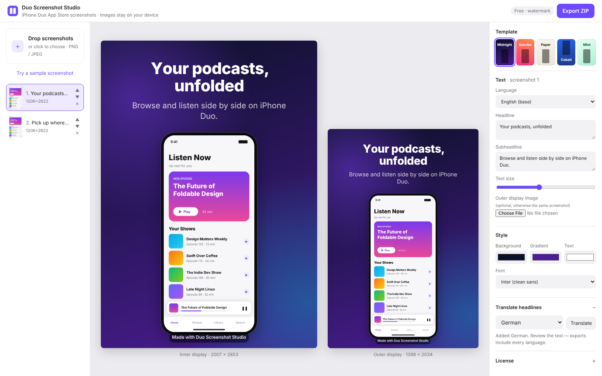
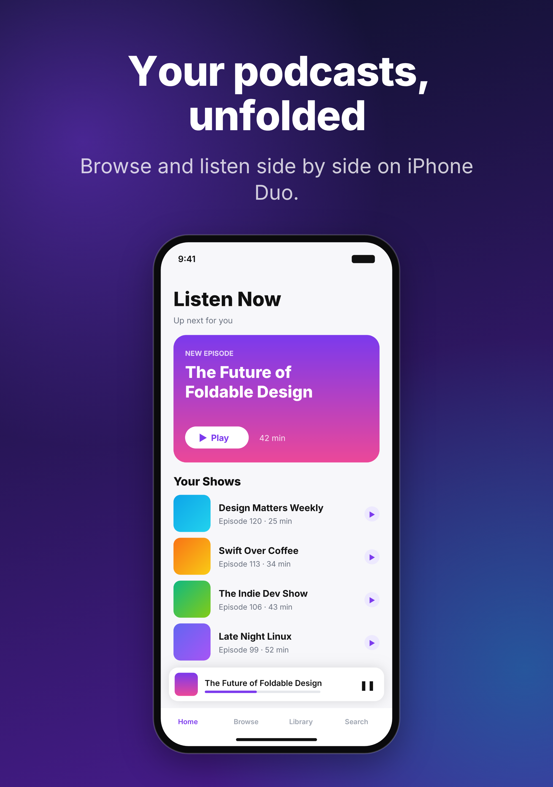
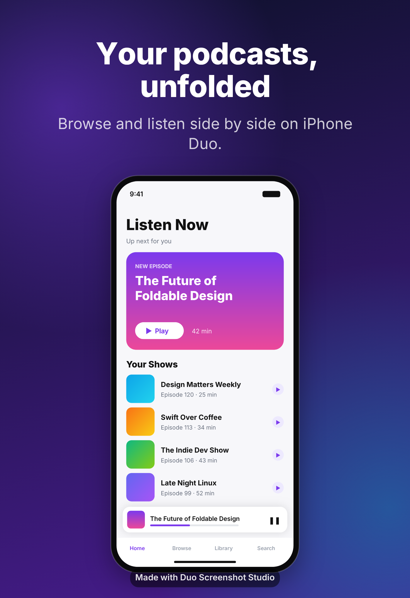

# HearHere Studio

Turn your existing App Store screenshots into **App Store-ready device screenshots**, with marketing headlines,
themes and translations, in a few minutes. Devices: **iPhone Duo** (inner and outer display), **iPhone 18 Pro Max**,
**iPhone Air** and **iPhone 18 Pro**. Pick them under *Devices* in the bottom bar; each one adds its App Store size to
every screenshot, and the export has a folder per size and language.

Everything runs in the browser. Screenshots are never uploaded: they're read with `URL.createObjectURL`,
drawn on a canvas and zipped locally. The only network calls are the Pro license check and the optional headline
translation, which sends **text only**.



| Sample export: inner display, 2007 × 2853 (licensed) | Outer display, 1398 × 2034 (free, watermark) |
|---|---|
|  |  |

## Features (MVP)

- Drag-and-drop or pick multiple screenshots; reorder and remove them. There's also a built-in sample screenshot.
- **Layouts** (where the device and text go): peek from left, peek from right, text on top, rise from bottom, drop from top. Landscape poses put the text beside the device; portrait canvases put it above.
- **Themes** (the look): Paper, Ink, Night, Sage, Mist and Clay. Flat grounds with a faint tone, Source Serif 4 or Inter headlines, balanced line breaks.
- A headline and subheadline per screenshot, background, gradient and text colors, 3 font choices (vendored Source Serif 4, Inter, plus System UI) and a text size slider.
- An optional separate image for the outer display, for example a real cover-screen capture.
- **Export ZIP** with every screenshot × both displays × every language, at Apple's exact pixel sizes.
  The PNGs are **8-bit RGB with no alpha channel**, because App Store Connect rejects transparency. A tiny PNG encoder in `src/png.js` handles this, since `canvas.toBlob` always writes RGBA.
- **Translate headlines (Pro):** pick any of 39 App Store languages and translate every headline at once with Claude. Each language becomes its own folder in the ZIP.
- **Boards, saved automatically:** everything on the canvas saves to the browser (IndexedDB) half a second after each change. Captures are scaled to at most 2868 px, re-encoded as WebP (JPEG where the browser can't) and stored once by SHA-256. A board menu switches, renames, duplicates and deletes boards, and exports or opens a `.hhstudio` backup (a ZIP of the board and its captures).
- **Sync (Pro, opt-in):** boards follow the license key across browsers. Everything is end-to-end encrypted in the browser (AES-GCM and HMAC keys derived from the license key with HKDF); the server only stores ciphertext. Writes are versioned, so when two browsers change the same board both versions are kept.
- **Free vs Pro:** free exports carry a small "Made with HearHere Studio" watermark. **Pro** (€15.99 one-time, sold on Polar) removes it and unlocks translation and sync.

## iPhone Duo screenshot sizes ✅ verified

| Display | Portrait | Landscape |
|---|---|---|
| Outer (cover) | **1398 × 2034** | 2034 × 1398 |
| Inner (unfolded) | **2007 × 2853** | 2853 × 2007 |

The rules are PNG or JPEG, 1–10 screenshots per size, and no alpha channel or transparency. Duo screenshots are optional today and **required from April 2027** for apps built with the iOS 27.1 SDK or later. Submitting them adds an "optimized for iPhone Duo" badge to the product page.

Sources, checked 2026-10-24:
- Apple, App Store Connect Help, *Screenshot specifications* (iPhone › iPhone Duo):
  https://developer.apple.com/help/app-store-connect/reference/app-information/screenshot-specifications/
- Apple Developer News, *Prepare and submit your apps for iPhone Duo*: https://developer.apple.com/news/?id=kkphp5qo
- App Store Connect release notes, Sep 9 and Oct 15, 2026: https://developer.apple.com/help/app-store-connect/release-notes/
- Secondary: https://appstorescreenshotstudio.com/posts/iphone-duo-app-store-screenshot-sizes/ notes that the inner
  *screenshot* size (2007 × 2853) is larger than the inner *panel* resolution (1878 × 2670). Use the spec size.

All sizes live in one constant: `DUO_SIZES` in `src/config.js`. Each display can be posed **portrait or landscape**
(Device › Inner display / Outer display), and the export uses the matching Apple size.

### Device frames and samples

- Devices, their App Store sizes, finishes and frame geometry live in `src/devices.js`. The Duo frames are
  `vendor/frames/<finish>/{inner,outer}-{portrait,landscape}.webp`; iPhone frames are portrait renders
  `vendor/frames/<device>/<finish>.webp` (from Figma's iOS 27 bezel kit, exported at 3×), turned a quarter for landscape.
  The screenshot is cover-fitted into the measured screen opening and the frame (with the camera) is drawn on top.
  A finish only shows up once its files exist.
- "Try a sample" loads real captures listed in `SAMPLE_SHOTS` (`src/sample.js`) from `samples/`, one per pose (HearHere captures).
  If they're missing it falls back to a generated screen at the current inner size.

## Run locally

The editor itself needs no build. Any static server works; ES modules just need http:// rather than file://.

```bash
python3 -m http.server 8000
# open http://localhost:8000
```

Konva 9.3.22, JSZip 3.10.2 and the fonts are vendored in `vendor/`, so the app works offline. Without the server
functions (below), the license check and translation say they're not available.

To run the full app with the server functions and a local D1 database, use Wrangler:

```bash
npm install
npm run dev        # builds, applies migrations/ to a local D1, and runs the Worker (local R2 too)
                   # put secrets in .dev.vars (gitignored)
```

## Build

`npm run build` writes the deployable site to `_site/`: index.html, the stylesheet, `vendor/`, `samples/`, and
`src/app.js` bundled and minified into one file. It stamps `?v=<commit>` on the asset links so browsers never mix old
and new files. Tests, docs and the server code are not published.

## Test

```bash
npm install
npm run test:functions        # server functions: Polar and Anthropic faked, D1 (node:sqlite) and R2 (a Map) emulated

cd tests && npm install && npx playwright install chromium
node e2e.mjs                  # the app in a real browser
node sync-e2e.mjs             # saving, backups, and two browsers syncing through the real sync handler
```

The browser test uploads screenshots, edits text inline, switches every theme and layout, checks that translation is
Pro-only, unlocks with a (faked) license, translates into two languages, and exports free, Pro and landscape ZIPs. It
checks every PNG for Apple's exact size and an RGB/no-alpha color type, and that the watermark goes away after
unlocking. It regenerates `docs/editor.png`, `docs/sample-export.png` and `docs/sample-export-outer-free.png`.

## Pro licenses (Polar) and translation (Claude)

Polar is the merchant of record: it sells Pro (€15.99 one-time, VAT included), handles VAT and receipts, and emails the
buyer a license key. The app never talks to Polar or Anthropic directly; two Cloudflare Pages Functions do:

- **`POST /api/license`** `{ key, device }`: activates the browser as a device on the key (Polar enforces the
  limit of 3), validates it, and caches a good result in D1 for a day. Keys are stored only as SHA-256 hashes.
- **`POST /api/claim`** `{ checkoutId, device }`: called when the buyer returns from Polar checkout. Reads the
  checkout, finds the license key Polar created for that customer (via a short customer session) and activates
  it, so Pro unlocks on the spot. Works for a week after the checkout; the key is also in the receipt email.
- **`POST /api/translate`** `{ key, device, sourceLanguage, targetLanguages[], texts[] }`: checks the license, then
  the monthly allowance (one run = all texts into one language), then calls Claude once per language with
  structured JSON output (Claude Haiku 5.5 by default). Only the text is sent, never images or the key.

- **`POST /api/sync/*`** (list, get, put, has, upload, download, delete-all): Pro sync, authenticated with the
  license key and device id in headers. Boards are rows in D1 (`sync_boards`, base64 ciphertext with a version for
  compare-and-set), images are objects in R2 under `<key hash>/<image id>`. A daily cron (`cleanupSync`) deletes images
  no board has used for 7 days, deletion markers after 90 days, and all data of keys revoked over 30 days ago.

All accept calls only from the app's own origin and are rate-limited per IP.

**Cloudflare setup** (Pages project connected to this repo):

| Setting | Value |
|---|---|
| Build command | `npm ci && npm run build` |
| Build output directory | `_site` |
| Custom domain | `studio.hearhere.media` |
| D1 binding | `DB` → the D1 database `studio`; `migrations/` is applied on deploy |
| Variable `POLAR_ORGANIZATION_ID` | your Polar organization ID |
| Variable `POLAR_BENEFIT_ID` | optional: only keys from this benefit unlock |
| Variable `ALLOWED_ORIGIN` | `https://studio.hearhere.media` |
| Variable `TRANSLATION_RUNS_PER_MONTH` | optional, default `500` (one = all changed lines into one language) |
| Variable `ANTHROPIC_MODEL` | optional, default `claude-haiku-5-5` |
| R2 binding | `SYNC` → bucket `studio-sync` (create once: `wrangler r2 bucket create studio-sync`) |
| Cron trigger | daily, runs the sync cleanup (in `wrangler.jsonc`) |
| Variables `SYNC_BYTES_PER_KEY`, `SYNC_MAX_BOARDS` | optional, default 1 GB and 200 boards per license key |
| Secret `POLAR_ACCESS_TOKEN` | Polar organization token with `license_keys:read`, `license_keys:write`, `checkouts:read` and `customer_sessions:write` |
| Secret `ANTHROPIC_API_KEY` | Anthropic API key (use a separate workspace with a spend limit) |

**Polar setup:** a one-time product "Duo Screenshot Studio Pro" at €15.99 with a License Keys benefit (prefix `DUO`,
no expiry, 3 activations, visible to the customer). Put its checkout link in `PRO.checkoutUrl` in `src/config.js`
and set the checkout success URL to `https://studio.hearhere.media/?checkout=success`, which opens the license
popover for the key.

The watermark is drawn in the browser, so a determined user could remove it by changing the code; the minified bundle
just makes that inconvenient. Translation is the part that can't be bypassed, because it runs on the server.

## TODO

- [ ] Polar: product, License Keys benefit, checkout link (`PRO.checkoutUrl`), access token, organization ID.
- [ ] Cloudflare Pages project, D1 database, variables and secrets (table above), domain `studio.hearhere.media`; then retire the GitHub Pages workflow.
- [ ] Privacy notice, terms and imprint pages.
- [ ] Check that Apple's device frame images may be shipped inside the tool; replace the sample screenshots with neutral artwork.
- [ ] Test in Safari and Firefox. The automated test only covers Chromium.
- [ ] Per-screenshot layout and theme overrides.
- [ ] Star White frames; fonts for Greek, Cyrillic, Arabic, Hebrew, Thai and CJK (they fall back to system fonts).
- [ ] A JPEG export option for smaller files. PNGs are around 1–3 MB each.
- [ ] More devices: iPhone, iPad, Mac and Apple Watch, using a device list instead of the fixed inner/outer pair.

## Project layout

```
index.html               app shell
src/config.js            DUO_SIZES, API endpoints, Pro price and checkout link, languages
src/templates.js         themes, layouts and fonts
src/frames.js            device frames and their measured screen openings
src/render.js            Konva layout for one screenshot on one display
src/png.js               RGB (no-alpha) PNG encoder
src/app.js               state, UI, inline editing, export, boards (save, open, backup)
src/store.js             IndexedDB: boards, images, settings
src/images.js            capture pipeline: scale, WebP, SHA-256
src/sync.js              Pro sync client: encryption, push/pull, conflicts
src/license.js           Pro license check (calls /api/license)
src/translate.js         translation client (calls /api/translate)
src/sample.js            sample screenshots (real captures in samples/, generated fallback)
functions/api/           API routes: license.js, translate.js, claim.js, sync.js
functions/_lib/          Polar license logic, HTTP helpers, language list
scripts/build.mjs        builds _site/
migrations/              D1 schema (applied on deploy)
tests/                   e2e.mjs, sync-e2e.mjs (browser), functions.test.mjs, sync.test.mjs (server)
vendor/                  Konva, JSZip, fonts, device frames (+ licenses)
```
